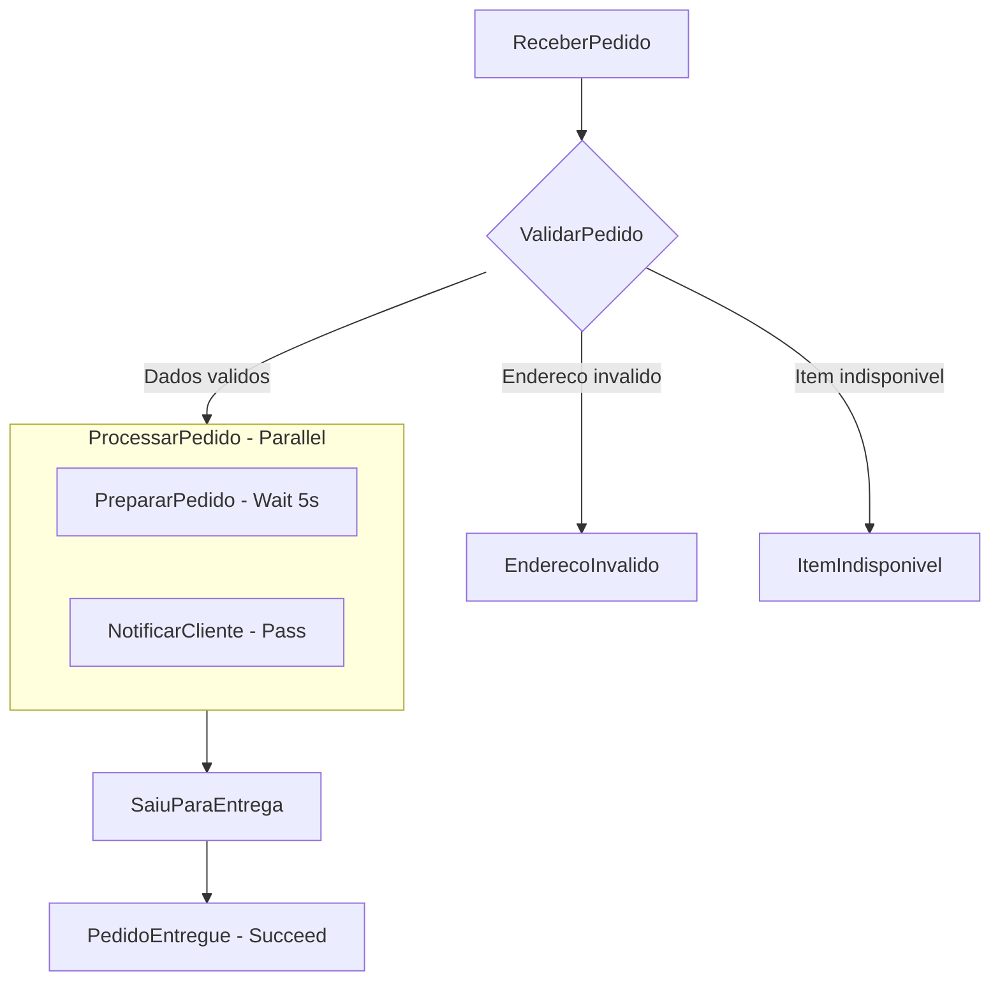

# Assistente de Delivery com AWS Step Functions

Orquestracao de fluxo de pedidos de delivery utilizando AWS Step Functions e Amazon States Language (ASL).

## Visao geral

Este projeto implementa uma maquina de estados para automacao e controle do ciclo de vida de pedidos em um sistema de delivery. O fluxo valida condicoes essenciais do pedido (disponibilidade de itens e validade do endereco), executa processamento paralelo (tempo de preparo e disparo de notificacao) e gerencia o status da entrega ate a conclusao. Desenvolvido como projeto pratico de conclusao de desafio da Digital Innovation One (DIO), com foco em arquitetura serverless orientada a eventos na AWS.

## Funcionalidades

- Validacao condicional de dados do pedido (endereco e disponibilidade de itens).
- Tratamento granular de falhas com estados de erro customizados (EnderecoInvalido e ItemIndisponivel).
- Processamento concorrente com estado Parallel para preparo simulado e notificacao do cliente em paralelo.
- Controle de transicao de estados ate a finalizacao com sucesso da entrega.
- Definicao declarativa em JSON utilizando o padrao Amazon States Language (ASL).

## Tecnologias

| Camada | Tecnologia |
|---|---|
| Orquestracao | AWS Step Functions |
| Padrao de Especificacao | Amazon States Language (ASL) / JSON |
| Nuvem | Amazon Web Services (AWS) |

## Arquitetura e estrutura de pastas

O fluxo orquestrado pelo AWS Step Functions segue o ciclo:



Estrutura de arquivos do projeto:

```
.
|-- .gitattributes         configuracao de normalizacao de quebras de linha
|-- .gitignore             regras de exclusao para Git
|-- LICENSE                licenca MIT
|-- README.md              documentacao tecnica do projeto
`-- state-machine.json     especificacao da maquina de estados em ASL
```

## Pre-requisitos

- Conta ativa na AWS (Amazon Web Services).
- Permissoes de IAM para criar e executar maquinas de estado no AWS Step Functions.
- Opcional: AWS CLI configurado localmente para criacao via linha de comando.

## Instalacao

Clone o repositorio:

```bash
git clone https://github.com/Rafael-Boaro/DIO-step-functions.git
cd DIO-step-functions
```

## Como executar

### Execucao via AWS Console

1. Acesse o console da AWS e navegue ate o servico **AWS Step Functions**.
2. Clique em **Criar maquina de estado** (Create state machine).
3. Selecione a opcao de criacao em branco ou edicao de codigo (Code).
4. Substitua o conteudo do editor pelo conteudo de `state-machine.json`.
5. Defina um nome para a maquina de estados (exemplo: `AssistenteDeliveryStepFunctions`).
6. Escolha ou crie uma role do IAM com permissoes padrao de execucao.
7. Clique em **Criar** (Create).
8. Para testar, clique em **Iniciar execucao** (Start execution).

### Execucao via AWS CLI (alternativa)

Criacao da maquina de estados:

```bash
aws stepfunctions create-state-machine \
  --name "AssistenteDeliveryStepFunctions" \
  --definition file://state-machine.json \
  --role-arn "arn:aws:iam::<ID_DA_CONTA>:role/<NOME_DA_ROLE>"
```

Inicio da execucao:

```bash
aws stepfunctions start-execution \
  --state-machine-arn "arn:aws:stepfunctions:<REGIAO>:<ID_DA_CONTA>:stateMachine:AssistenteDeliveryStepFunctions"
```

## Testes

A maquina de estados permite validar tres cenarios principais por meio de cargas uteis (payloads) de entrada:

### 1. Fluxo feliz (pedido valido e entregue)

Carga util de entrada ou payload inicial definido no estado `ReceberPedido`:

```json
{
  "cliente": "Rafael",
  "item": "Pizza",
  "enderecoValido": true,
  "itemDisponivel": true
}
```

Resultado esperado: O fluxo passa por `ValidarPedido`, executa `ProcessarPedido` em paralelo, transita para `SaiuParaEntrega` e finaliza com sucesso no estado `PedidoEntregue`.

### 2. Endereco invalido

Altere o campo `enderecoValido` para `false`:

```json
{
  "cliente": "Rafael",
  "item": "Pizza",
  "enderecoValido": false,
  "itemDisponivel": true
}
```

Resultado esperado: Transicao para o estado de erro `EnderecoInvalido` com falha controlada e causa informada.

### 3. Item indisponivel

Altere o campo `itemDisponivel` para `false`:

```json
{
  "cliente": "Rafael",
  "item": "Pizza",
  "enderecoValido": true,
  "itemDisponivel": false
}
```

Resultado esperado: Transicao para o estado de erro `ItemIndisponivel` com falha controlada e causa informada.

## Decisoes tecnicas

- **Amazon States Language (ASL):** Adocao do padrao nativo da AWS para orquestracao declarativa e desacoplada, facilitando manutencao, auditoria e observabilidade no console.
- **Tipo Parallel:** Utilizacao de processamento paralelo para desacoplar tarefas assincronas (preparo do pedido e envio de confirmacao ao cliente), reduzindo o tempo total de resposta.
- **Estados Choice e Fail:** Implementacao de controle de fluxo defensivo, garantindo que inconsistencias no pedido sejam tratadas antes de consumir recursos computacionais de processamento.

## Roadmap

- [ ] Integrar AWS Lambda functions para validar dados em banco de dados real.
- [ ] Integrar Amazon SNS para envio de SMS/e-mail real na etapa NotificarCliente.
- [ ] Persistir o historico e status do pedido em tabela do Amazon DynamoDB.

## Autor

Rafael Paolielo Boaro  
GitHub: [Rafael-Boaro](https://github.com/Rafael-Boaro)

## Licenca

Distribuido sob a licenca MIT. Veja o arquivo LICENSE para mais detalhes.
